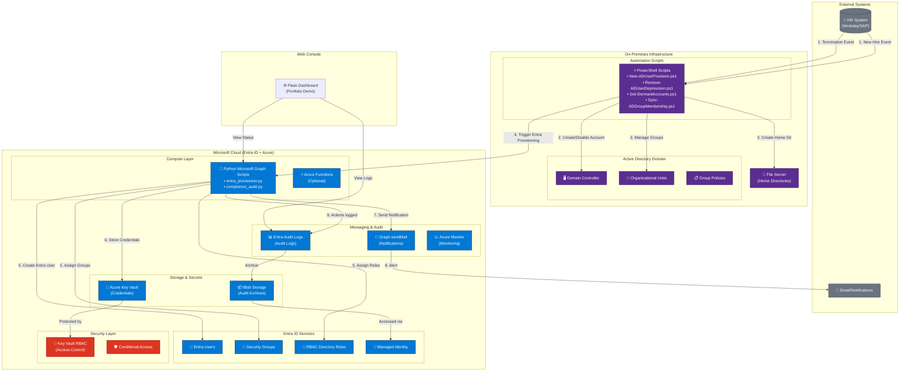
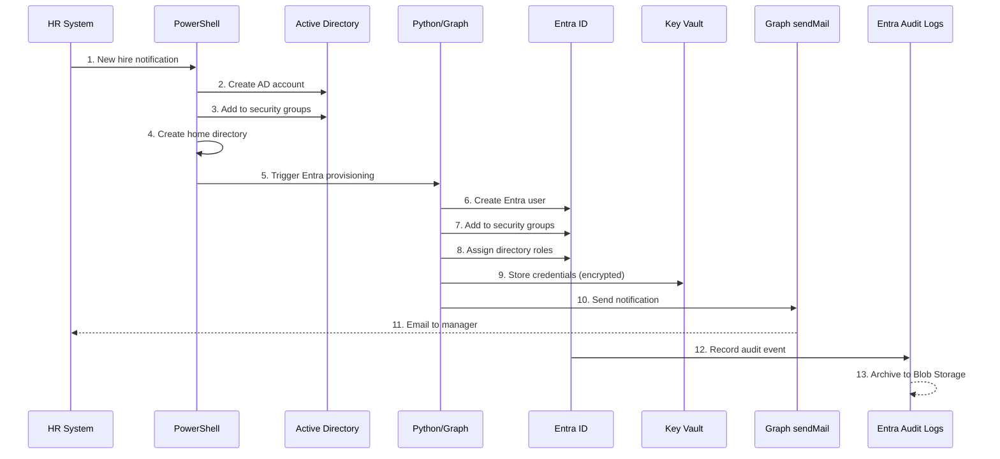
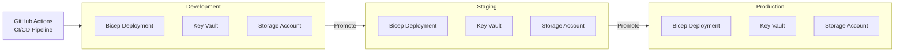

# IAM Lifecycle Automation Platform - Architecture

## System Architecture Overview

This document describes the architecture of the IAM Lifecycle Automation Platform (Microsoft Entra ID edition), including data flows, components, and security boundaries.

## Architecture Diagram

## Component Details

### 1. HR System Integration
- **Source**: Workday, SAP, or similar HRIS
- **Events**: New hire, termination, department transfer, role change
- **Integration**: CSV export, API webhooks, or scheduled sync

### 2. PowerShell Scripts (On-Premises)

| Script | Purpose |
|--------|---------|
| `New-ADUserProvision.ps1` | Create AD accounts with proper OU placement, group memberships |
| `Remove-ADUserDeprovision.ps1` | Disable accounts, revoke access, archive data |
| `Get-DormantAccounts.ps1` | Identify inactive accounts for compliance |
| `Sync-ADGroupMembership.ps1` | Synchronize group memberships based on roles |

### 3. Python Microsoft Graph Scripts (Entra ID)

| Script | Purpose |
|--------|---------|
| `entra_provisioner.py` | Create Entra users, add security groups, assign directory roles |
| `compliance_audit.py` | CIS benchmark checks, credential age analysis |

### 4. Microsoft Entra ID and Azure Services

| Service | Purpose |
|---------|---------|
| **Microsoft Entra ID** | User/group/directory role management |
| **Azure Key Vault** | Secure credential storage with versioning |
| **Blob Storage** | Audit log archival with 7-year retention |
| **Microsoft Graph sendMail** | Real-time notifications to managers |
| **Entra audit and sign-in logs** | Complete audit trail of all identity actions |
| **Managed identity** | Credential-free access to Key Vault and Storage |
| **Azure Monitor** | Monitoring and alerting |

## Data Flow Sequence

## Security Boundaries

### Network Security
- **Key Vault firewall**: Trusted Azure services bypass, deny-by-default available
- **Storage**: HTTPS only, no public blob access, TLS 1.2 minimum
- **Conditional Access**: Sign-in conditions for the automation and admin accounts

### Identity Security
- **Least Privilege**: Minimal permissions per role
- **MFA Required**: Audited for every user who signs in
- **Password Policy**: Temporary password, change required at next sign-in

### Data Security
- **Encryption at Rest**: Key Vault and Blob Storage (Microsoft-managed keys)
- **Encryption in Transit**: TLS 1.2+ for all communications
- **Secret Versioning**: Every credential write is a new Key Vault secret version

### Audit & Compliance
- **Entra audit logs**: All directory changes logged
- **Retention**: 7-year log retention for compliance
- **Immutability**: Time-based retention on the archive container in production

## Microsoft Well-Architected Alignment

| Pillar | Implementation |
|--------|----------------|
| **Security** | Key Vault RBAC, least-privilege directory roles, managed identity |
| **Reliability** | Zone-redundant options, retry logic, error handling |
| **Cost Optimization** | Serverless components, lifecycle policies |
| **Operational Excellence** | Entra audit logs, Azure Monitor, automated responses |
| **Performance** | Graph batching-ready calls, efficient API usage |
| **Sustainability** | Right-sized resources, lifecycle policies |

## Deployment Architecture

## Cost Estimation

| Service | Monthly Cost (Estimated) |
|---------|-------------------------|
| Microsoft Entra ID | Included (sign-in activity needs P1) |
| Blob Storage (audit archive) | Cents per GB |
| Azure Key Vault | ~$0.03 per 10,000 operations |
| Microsoft Graph sendMail | Included with an Exchange Online mailbox |
| Entra audit logs | Included |
| Managed identity | Free |
| **Total** | **Under $1/month** |

---

*Last Updated: October 2026*
*Author: Mohammad Khan*

